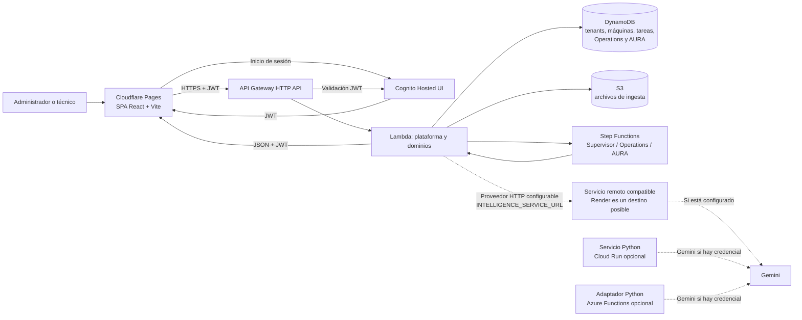
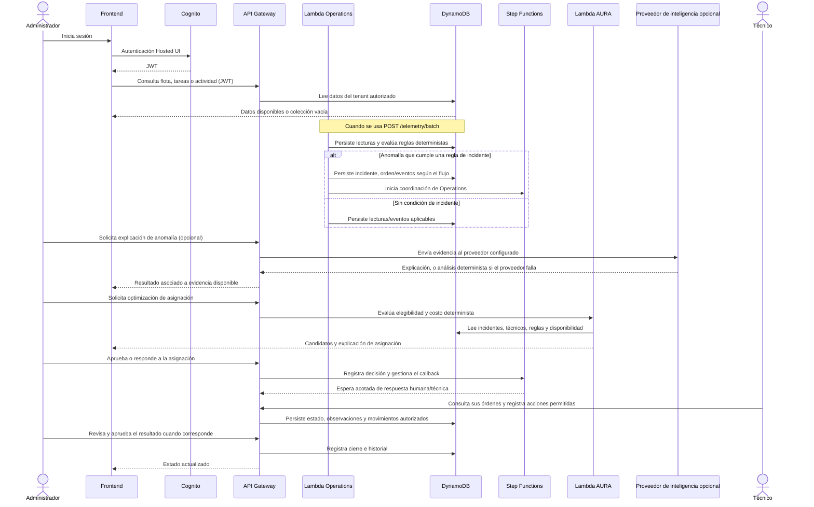

# ArquiFusion Corp — Enterprise 2.0

> **Plataforma multinube de inteligencia y gestión de operaciones industriales.**

ArquiFusion Corp reúne en una sola plataforma la supervisión de maquinaria, los incidentes, el mantenimiento, los técnicos, los repuestos y la actividad operativa. Está pensado para equipos industriales, supervisores y administradores que necesitan convertir datos de operación en tareas trazables. También ofrece una base técnica reproducible para estudiantes y desarrolladores que quieran explorar una arquitectura serverless con más de un proveedor cloud.

La plataforma combina una aplicación React, APIs protegidas, almacenamiento persistente, reglas de análisis deterministas y proveedores de inteligencia configurables. La interfaz muestra información obtenida de los servicios disponibles; no presenta métricas de ahorro ni resultados operativos estimados como hechos.

> **Estado del repositorio:** este README describe el código y la configuración presentes en este repositorio. No certifica que cada stack esté desplegado o disponible en una cuenta cloud. El backend Supervisor existente puede estar desplegado por separado; Operations y AURA están implementados como stacks adicionales en el repositorio y requieren revisión y despliegue antes de usarse en AWS.

---

## El problema

En muchas operaciones industriales, el estado de las máquinas, los avisos de fallas, las órdenes de trabajo, los técnicos y el inventario se administran en herramientas separadas o mediante procesos manuales. Esto dificulta:

- Saber qué equipos operan, están en mantenimiento o requieren atención.
- Dar seguimiento a incidentes desde su detección hasta su resolución.
- Coordinar personal con las habilidades y disponibilidad adecuadas.
- Evitar demoras causadas por órdenes incompletas o repuestos no disponibles.
- Mantener un historial verificable de decisiones y cambios.
- Usar los datos existentes para orientar la siguiente acción.

La fragmentación puede retrasar la respuesta y reducir la visibilidad de la operación. ArquiFusion busca reunir esos datos y flujos; no presupone ni promete un porcentaje de mejora.

## La solución

El monorepo contiene una aplicación de operaciones industriales y varios servicios desacoplados:

- **Supervisión de flota:** consulta de máquinas y métricas disponibles.
- **Ingesta:** recepción de archivos CSV y JSON en el backend Supervisor.
- **Tareas y actividad:** envío y seguimiento de tareas, eventos y resumen operativo.
- **Operations:** telemetría por lotes, evaluación de reglas de anomalía, incidentes, órdenes de mantenimiento y eventos.
- **AURA:** técnicos, elegibilidad y asignación determinista, inventario, reservas y coordinación de órdenes.
- **Inteligencia:** reglas deterministas en AWS y adaptadores de proveedores remotos; el análisis generativo es opcional y depende de la configuración del servicio.
- **Frontend:** Centro de mando y módulos de flota, inteligencia, actividad, ingesta, incidentes, mantenimiento, técnicos, inventario y coordinación.

Las capacidades descritas como **implementadas en código** cuentan con rutas, servicios o componentes en el repositorio. Esto no significa que todos los stacks estén desplegados, que una cuenta disponga de los permisos necesarios ni que haya datos en ella. Los módulos Operations y AURA están definidos como stacks adicionales y sus procedimientos de despliegue requieren revisión en el entorno objetivo. El frontend puede mostrar estados vacíos cuando no recibe datos.

## Arquitectura multinube

### Vista general



Las líneas discontinuas indican integraciones opcionales/configurables, no una dependencia automática de cada flujo. El navegador llama a la API AWS; **no llama directamente a Gemini**. La URL de proveedor remoto se configura en backend. No se encontró en este checkout una definición de infraestructura de Render ni evidencia verificable de su estado actual. El código de AWS contiene un proveedor HTTP remoto (el comentario de implementación alude a Render); Google Cloud Run y Azure Functions tienen implementaciones opcionales del servicio de inteligencia.

### AWS — plano operativo principal

Las configuraciones Serverless del directorio [`cloud/aws/`](cloud/aws/README.md) organizan la plataforma y los dominios. Los servicios confirmados en configuración y código incluyen:

| Servicio | Función en el repositorio |
|---|---|
| API Gateway HTTP API | Expone las rutas HTTP. Los stacks de dominio pueden registrar rutas en una API existente. |
| AWS Lambda, Node.js 24 | Ejecuta la lógica TypeScript de plataforma, flota, ingesta, inteligencia, Supervisor, Operations y AURA. |
| Amazon Cognito | Emite la identidad JWT que usa el authorizer de la API. La plantilla de Cognito es una configuración separada/opcional; no se debe asumir que el stack la crea. |
| Amazon DynamoDB | Persiste tenants, máquinas, tareas y registros de Operations/AURA, con patrones de consulta e índices descritos en la documentación de cada dominio. |
| Amazon S3 | Guarda archivos originales de ingesta en la configuración de plataforma. |
| AWS Step Functions | Orquesta flujos separados de Supervisor, Operations y AURA. El flujo AURA contempla espera de confirmación humana mediante callback gestionado por backend. |

La configuración usa stacks separados, pero algunos dominios comparten API, tablas, authorizer o roles existentes. Por ello, el orden, los identificadores y la titularidad de recursos deben comprobarse antes de desplegar. No hay que interpretar los archivos Serverless como prueba de que esos recursos existen en una cuenta determinada. No se encontraron configuraciones de EventBridge o SQS para este flujo.

### Google Cloud

`cloud/gcp/intelligence/` implementa un servicio HTTP Python orientado a Cloud Run. Define `GET /health` y `POST /v1/intelligence/analyze`, valida el contrato compartido y puede invocar Gemini mediante `google-genai` cuando se configura `GEMINI_API_KEY`. El servicio no accede directamente a las tablas AWS.

La guía histórica [`cloud/gcp/intelligence/README.md`](cloud/gcp/intelligence/README.md) todavía describe un proveedor no configurado; el código actual incluye `provider.py` para Gemini. Para habilitar ese análisis se requieren dependencias Python y variables protegidas del servicio, incluyendo `GEMINI_API_KEY` y `INTELLIGENCE_API_KEY`.

El backend AWS también acepta un proveedor HTTP de inteligencia configurable y conserva un resultado determinista si la llamada remota falla. La integración no queda conectada por defecto solo por existir el servicio GCP: URL, credenciales de servicio, tiempo de espera y disponibilidad deben configurarse en el entorno que lo use. El código de Cloud Run y las pruebas locales no prueban que haya un servicio desplegado.

### Tercera plataforma de ejecución: Render como destino compatible

La integración AWS permite configurar un servicio de inteligencia HTTP externo y el código menciona Render como posible proveedor remoto. Sin embargo, este repositorio no contiene un manifiesto de Render ni permite confirmar la URL, credenciales, despliegue o disponibilidad de esa instancia. Por eso, Render se documenta como **destino compatible referido por la integración**, no como infraestructura verificable desde este checkout.

También existe `cloud/azure/intelligence/`, un adaptador Azure Functions (Python 3.12) que reutiliza el paquete de inteligencia y dispone de un script de publicación. Es una alternativa opcional; su existencia tampoco demuestra un despliegue. Gemini es el proveedor de modelo, no una nube de cómputo adicional del proyecto.

### Cloudflare Pages

Cloudflare Pages aloja la aplicación web estática. No ejecuta el backend AWS ni el servicio de inteligencia. Las instrucciones de build y las variables `VITE_*` están en [`apps/frontend/README.md`](apps/frontend/README.md). La publicación del sitio no se ha realizado desde este repositorio.

## Flujo de operación

El siguiente flujo describe las rutas y servicios implementados. Algunos pasos dependen de que Operations/AURA estén desplegados y configurados, y las acciones críticas conservan aprobación humana.



La telemetría batch puede generar anomalías mediante reglas configuradas. La creación de incidentes y órdenes depende de la regla y severidad definidas en Operations; el análisis generativo explica evidencia, pero no ejecuta una reparación. AURA calcula asignaciones con lógica determinista y la aprobación se registra por una acción autorizada. La entrega externa de notificaciones no debe inferirse de un evento persistido: en Operations, un evento de notificación solicitada no prueba que se haya enviado un mensaje.

## Módulos

| Módulo | Función | Capacidades presentes en el código | Estado documentado |
|---|---|---|---|
| Centro de mando | Resumen operativo | Vista ejecutiva que consume resúmenes e indicadores disponibles; estado vacío si no hay datos. | Frontend implementado; datos requieren API y permisos disponibles. |
| Flota | Consulta de maquinaria | Lista y detalle de máquinas, métricas y búsqueda/estados según el contrato. | Rutas y UI existentes. |
| Centro de agentes | Envío/seguimiento de tareas e inteligencia | Agentes, recomendaciones y tareas del Supervisor. | Supervisor conserva su stack; proveedor remoto es configurable. |
| Ingesta | Incorporar datos | `POST /ingest/csv` y `POST /ingest/json`; almacenamiento de originales en S3 en modo AWS. | Código de backend y UI existentes. |
| Actividad del sistema | Trazabilidad | Eventos de Supervisor y eventos de dominios que estén desplegados. | Paginación/filtrado dependen de la fuente API seleccionada. |
| Incidentes | Registrar y seguir anomalías confirmadas o manuales | `GET/POST /incidents`, actualización de estado y creación de orden desde incidente. | Operations implementado como stack adicional; despliegue por verificar. |
| Mantenimiento | Órdenes y avance de trabajo | Consulta/actualización de órdenes; acciones de técnico y revisión administrativa en AURA. | Código en Operations/AURA; despliegue por verificar. |
| Técnicos | Perfiles, disponibilidad y trabajos | CRUD, invitación de cuenta, consulta personal y elegibilidad para asignación. | AURA implementado como stack adicional; despliegue por verificar. |
| Inventario | Repuestos y existencias | Catálogo, stock, alertas, movimientos, reservas/liberación/consumo con control de concurrencia. | AURA implementado como stack adicional; despliegue por verificar. |
| Orquestación AURA | Coordinar asignaciones e intervención | Optimización, aprobación, eventos y state machine separado con espera de callback. | Código y contratos presentes; requiere infraestructura y permisos confirmados. |
| Inteligencia GCP/Azure | Analizar evidencia con proveedor configurable | Servicio Python GCP y adaptador Azure Functions, además del proveedor HTTP del backend. | Alternativas de código; despliegue/configuración no demostrados aquí. |

Las rutas y contratos exactos están versionados en [`packages/contracts/openapi/`](packages/contracts/openapi/) y se complementan con los documentos de [Operations](cloud/aws/OPERATIONS-MVP.md) y [AURA](cloud/aws/AURA-ARCHITECTURE.md).

## AURA — Adaptive Unified Response & Assignment

AURA es la capa de coordinación determinista para convertir un incidente elegible en una propuesta de asignación y una intervención trazable.

- **Entradas:** requisitos del incidente/orden, especialidades y habilidades, disponibilidad, turnos, capacidad/carga y ubicación cuando las coordenadas confiables existen.
- **Elegibilidad:** descarta técnicos que no cumplen requisitos operativos configurados.
- **Optimización:** contiene un algoritmo húngaro para asignar varios técnicos a varios incidentes minimizando un costo global. Admite matrices rectangulares, incompatibilidades y conjunto vacío; las razones/costos se pueden explicar.
- **Ubicación:** la distancia solo se usa si hay coordenadas válidas. El código no debe presentarse como estimador de tiempos reales de traslado.
- **Inventario:** las reservas y movimientos usan escrituras condicionales/transacciones e idempotencia para reducir el riesgo de stock negativo y dobles consumos.
- **Orquestación:** el flujo AURA es independiente del Supervisor. Los tokens de callback pertenecen al backend; la confirmación humana tiene plazo/reintentos definidos en la configuración del flujo.
- **IA:** un proveedor generativo configurado puede explicar recomendaciones usando evidencia. La asignación y las acciones críticas siguen el flujo determinista y requieren la aprobación prevista; Gemini no ejecuta automáticamente una reparación.

Consulta [AURA-ARCHITECTURE.md](cloud/aws/AURA-ARCHITECTURE.md) y [AURA-IMPLEMENTATION.md](cloud/aws/AURA-IMPLEMENTATION.md) para estados, tablas, contratos y consideraciones operativas.

## Ecosistema de agentes inteligentes — AURA

AURA busca apoyar la supervisión y coordinación de operaciones industriales, relacionando información de maquinaria, mantenimiento, incidentes, inventario y personal técnico. En la interfaz aparecen seis especialidades con el estado **Planificado**. Son una arquitectura objetivo representada en el frontend; el repositorio no contiene seis agentes autónomos independientes ejecutándose.

### Capacidades y estado comprobable

| Agente | Problema que busca resolver | Información de entrada | Responsabilidad | Resultado esperado | Estado real en el repositorio |
|---|---|---|---|---|---|
| Coordinador | Reunir señales de las especialidades y facilitar la coordinación de recomendaciones y decisiones operativas. | Resultados de flota, incidentes, mantenimiento, inventario y asignaciones disponibles. | Relacionar los resultados, señalar dependencias y preparar una propuesta común para revisión. | Una síntesis contextual y una secuencia de acciones propuestas para revisión. | **Planificado.** La tarjeta del frontend está marcada así; no existe un agente coordinador autónomo implementado. |
| Mantenimiento predictivo | Detectar señales de desgaste o posibles fallas antes de una parada inesperada. | Telemetría disponible, historial de mantenimiento y reglas operativas. | Evaluar tendencias con datos suficientes y señalar cuándo conviene inspeccionar, sin inventar predicciones. | Una señal para priorizar una inspección, con evidencia y límites explícitos. | **Planificado como agente predictivo.** Operations implementa reglas de anomalía, pero eso no constituye un modelo predictivo ni una predicción estadística. |
| Operaciones de flota | Identificar equipos cuyo estado, actividad o disponibilidad requiere atención. | Máquinas, estados, métricas e información de flota recibida. | Revisar estados y reglas disponibles; asociar observaciones al equipo correspondiente. | Recomendaciones de operación asociadas a una máquina y evidencia disponible. | **Parcialmente implementado.** Existe una evaluación determinista de flota y el flujo Supervisor de recomendaciones/tareas. La tarjeta especializada sigue planificada; el proveedor Gemini requiere configuración y no sustituye las reglas. |
| Inteligencia de inventario | Relacionar repuestos, existencias, ubicaciones, reservas y alertas con necesidades de trabajo. | Catálogo, saldos, movimientos, mínimos y órdenes de mantenimiento. | Comprobar disponibilidad y alertar sobre faltantes antes o durante una orden. | Información de disponibilidad y posibles necesidades de reposición o reserva. | **Parcialmente implementado.** El backend AURA contiene operaciones de inventario y reservas; el agente especializado está planificado y el stack AURA requiere despliegue/configuración. |
| Asignación de técnicos | Ayudar a seleccionar una persona elegible según especialidad, habilidades, disponibilidad y carga. | Requisitos de la orden/incidente, perfiles, turnos, disponibilidad y capacidad; ubicación solo con coordenadas válidas. | Filtrar candidatos no elegibles y calcular una asignación de costo global explicable. | Una propuesta determinista de asignación explicable para aprobación. | **Parcialmente implementado.** El backend incluye elegibilidad y optimización húngara, pero no un agente autónomo; la asignación requiere la aprobación humana prevista y el stack AURA no se considera desplegado por este repositorio. |
| Inteligencia de incidentes | Analizar sucesos registrados y facilitar la identificación de acciones correctivas. | Incidente, anomalía, telemetría/evidencia asociada y actividad previa disponible. | Relacionar evidencia y estado con una acción correctiva que debe revisar un usuario autorizado. | Contexto de atención o propuesta para crear/actualizar una orden correctiva. | **Parcialmente implementado.** Operations implementa reglas, persistencia de incidentes y órdenes; la especialidad agente de incidentes mostrada en frontend sigue planificada. |

### Implementado, parcial y dependiente de configuración

- **Implementado en código:** el frontend ejecuta la evaluación actual de flota mediante el flujo Supervisor; las reglas deterministas de Operations pueden evaluar lecturas y registrar anomalías/incidentes según configuración; AURA contiene lógica de asignación, inventario y coordinación en stacks separados.
- **Parcial:** las funciones de Operations/AURA están en el repositorio, pero requieren que sus stacks y recursos compartidos se desplieguen y configuren. Los perfiles y tarjetas de seis especialidades no significan que haya seis procesos de agente ejecutándose.
- **Planificado:** los roles predictivo, coordinador, inventario e incidentes como agentes especializados, y la operación multiagente autónoma reflejada en la interfaz.
- **Integración externa:** Gemini está detrás de proveedores de servidor configurables. Se necesitan URL, credenciales protegidas y un servicio disponible. El navegador no invoca Gemini directamente. La respuesta generativa puede fallar o no estar configurada; las reglas deterministas no dependen de ella.
- **Aprobación:** una recomendación no ejecuta por sí sola una reparación, una asignación o un cambio crítico. Las aprobaciones y transiciones quedan a cargo de los actores autorizados según el flujo y contrato desplegados.

### Ejemplo de flujo: temperatura elevada

1. **Lectura recibida — integración o carga:** una fuente envía telemetría de temperatura para una máquina mediante el contrato de Operations.
2. **Detección — automática, si la regla está configurada:** las reglas deterministas evalúan la lectura; no se infiere una falla si los datos o umbrales necesarios faltan.
3. **Incidente — automático bajo una regla aplicable o manual por un administrador:** se conserva la evidencia disponible y se registra el evento correspondiente.
4. **Análisis — solicitado por una persona o proceso autorizado:** Gemini puede elaborar una explicación si el proveedor externo está configurado; ante su ausencia o fallo permanece disponible el resultado determinista que corresponda.
5. **Propuesta de mantenimiento — según regla o acción administrativa:** Operations puede generar una orden al confirmar una anomalía según sus reglas. También existe creación manual de una orden desde el incidente, aunque no haya análisis Gemini.
6. **Asignación — cálculo determinista, aprobación humana:** AURA calcula candidatos elegibles; un administrador revisa y confirma la asignación.
7. **Repuestos — acción autorizada:** el inventario permite consultar saldos y operar reservas/movimientos mediante controles de persistencia. La reserva no debe darse por realizada solo porque exista una recomendación.
8. **Ejecución y cierre — técnico y revisión administrativa:** el técnico registra las acciones permitidas y completa el trabajo; la aprobación/cierre se registra por el actor autorizado y queda en el historial.

Este recorrido describe capacidades del código y contratos. No afirma que el circuito completo esté activo en AWS: Operations y AURA necesitan despliegue y validación del entorno antes de una demostración conectada.

## Tecnologías

Las versiones indicadas proceden de los manifiestos del repositorio y pueden incluir rangos semver.

| Área | Tecnologías |
|---|---|
| Frontend | React `^18.3.1`, TypeScript `^5.7.3`, Vite `^8.3.8`, `lucide-react` `^0.468.0`. |
| Backend | Node.js 24, TypeScript `^5.7.3`, AWS SDK v3, Serverless Framework `^4.9.0`, `aws-jwt-verify` `5.2.1`, LangGraph `^1.7.4`. |
| AWS | API Gateway HTTP API, Lambda, DynamoDB, Cognito, S3 y Step Functions. |
| Google Cloud | Python 3.12+, Cloud Run (servicio HTTP opcional), `google-genai` `>=1.0`. |
| Azure | Azure Functions v4 con Python 3.12; `azure-functions >=1.21,<2` y `google-genai >=1.0.0`. |
| Persistencia | DynamoDB para los dominios AWS; S3 para objetos de ingesta. El servicio de inteligencia externo no importa ni consulta directamente esas tablas. |
| Identidad | Cognito Hosted UI/JWT para el frontend y authorizer JWT en API Gateway. |
| Herramientas | npm workspaces, Python `unittest`, Node.js test runner, `tsc`, validación local de infraestructura y Mermaid. |

## Requisitos previos

- Git.
- Node.js **24.x** y npm **10 o superior** (`.nvmrc` fija Node 24).
- Python **3.12 o superior** para la suite y los servicios de inteligencia.
- Docker solo si se desea construir/probar la imagen de Cloud Run.
- Credenciales/permisos de AWS solo para interactuar con una cuenta o desplegar. No son necesarios para instalar ni ejecutar los tests unitarios/locales documentados.

## Instalación y ejecución local

### 1. Clonar e instalar

```powershell
git clone https://github.com/Pepe17xd/ArquiFusion-Corp.git
cd ArquiFusion-Corp
node --version
npm --version
npm ci
```

El repositorio usa npm workspaces para `cloud/aws` y `apps/frontend`; instala desde la raíz para respetar el `package-lock.json` único.

### 2. Variables de entorno

El archivo raíz [`.env.example`](.env.example) sirve como referencia. Para la configuración de Vite, crea un archivo `.env` local (no lo subas a Git):

```powershell
Copy-Item .env.example .env
```

Las variables públicas del frontend realmente consumidas son:

| Variable | Uso |
|---|---|
| `VITE_API_URL` | URL base de la API. En producción, el código usa la API Gateway pública configurada para el proyecto; en desarrollo Vite usa `/api` y el proxy apunta a `http://localhost:3001` si no se define. |
| `VITE_AUTH_MODE` | `local` para vista local; `cognito` para el flujo Hosted UI. |
| `VITE_COGNITO_CLIENT_ID` | Identificador público del app client. |
| `VITE_COGNITO_DOMAIN` | Dominio HTTPS de Cognito Hosted UI. |
| `VITE_COGNITO_REDIRECT_URI` | URL de callback autorizada, por ejemplo `http://localhost:5173/auth/callback`. |

`VITE_*` se incorpora al bundle del navegador y **no debe contener secretos**. No configures claves privadas, tokens, contraseñas, credenciales de AWS ni `GEMINI_API_KEY` en variables del frontend. Cognito Hosted UI requiere que las URL de callback y salida estén registradas en el user pool correspondiente.

El frontend local en modo `local` permite revisar la interfaz con estados vacíos y no necesita conectarse a AWS. Para autenticación y datos AWS, configura `VITE_AUTH_MODE=cognito`, la URL API y los valores públicos de Cognito del entorno autorizado. Tenerlos en `.env` no crea usuarios, no garantiza permisos y no prueba disponibilidad de la API.

Las variables no `VITE_*` del ejemplo corresponden al backend/infraestructura. El proceso Node local no carga automáticamente `.env`; establece las variables necesarias en el entorno de la terminal siguiendo [`cloud/aws/README.md`](cloud/aws/README.md). No reutilices una configuración de despliegue contra producción para una prueba local.

### 3. Ejecutar el frontend

Desde la raíz:

```powershell
npm run dev:web
```

Vite escucha en `http://127.0.0.1:5173`. Para conectarlo a una API local, el proxy `/api` apunta al servidor de desarrollo en `http://localhost:3001`; la vista local predeterminada puede evitar llamadas y mostrar estados vacíos.

### 4. Ejecutar el backend local

El servidor local implementado puede iniciarse en otra terminal:

```powershell
npm run dev:api
```

El servidor escucha en el puerto 3001. En PowerShell, configura el modo local en esa terminal antes de iniciarlo:

```powershell
$env:STORAGE_MODE = "local"
$env:AUTH_MODE = "local"
npm run dev:api
```

El modo local de almacenamiento/autenticación se describe en [`cloud/aws/README.md`](cloud/aws/README.md). Este proceso permite trabajar con la API local; no equivale a simular todos los servicios administrados de AWS ni a una integración E2E con Cognito/Step Functions.

### 5. Servicio de inteligencia Python (opcional)

Para ejecutar el servicio HTTP local de Google Cloud:

```powershell
npm run dev:intelligence
```

Revisa [`cloud/gcp/intelligence/README.md`](cloud/gcp/intelligence/README.md) para las instrucciones de contenedor y contrato (la nota sobre el proveedor está desactualizada; ver `provider.py`). Sin `GEMINI_API_KEY`, el proveedor generativo no está disponible; no añadas esa clave al frontend ni al repositorio. Para habilitarlo localmente instala la dependencia declarada en `pyproject.toml` con `python -m pip install -e cloud/gcp/intelligence` y configura las variables protegidas `GEMINI_API_KEY` e `INTELLIGENCE_API_KEY` en la terminal. El servicio puede iniciar independientemente y no se conecta automáticamente al flujo principal.

No existe un comando raíz llamado “modo demo” que active datos ficticios para el frontend. El script `demo:enterprise` del backend es un mecanismo de preparación de datos para un entorno seleccionado y puede escribir en AWS; consulta primero su documentación y configuración antes de ejecutarlo. No se incluye aquí como paso de arranque local inocuo.

## Contratos y rutas

Las especificaciones OpenAPI versionadas están en [`packages/contracts/openapi/`](packages/contracts/openapi/); los eventos compartidos usan [`packages/contracts/events.schema.json`](packages/contracts/events.schema.json). Entre las rutas principales definidas por los stacks se encuentran:

| Dominio | Ejemplos de rutas |
|---|---|
| Plataforma / tenants | `GET /health` (pública), `GET /tenants`, `POST /tenants` |
| Flota | `GET /machines`, `GET /machines/{machineId}`, `GET /metrics` |
| Ingesta | `POST /ingest/csv`, `POST /ingest/json` |
| Supervisor | `GET/POST /tasks`, `GET /tasks/{taskId}`, `GET /events`, `GET /operations/overview` |
| Operations | `POST /telemetry/batch`, `GET /telemetry`, `GET /telemetry/latest`, `GET/POST /incidents`, `PATCH /incidents/{incidentId}`, rutas de anomalías y órdenes de mantenimiento |
| AURA | Técnicos, órdenes personales, inventario, movimientos, reservas, asignaciones, aprobaciones, KPIs y eventos; contratos exactos en `aura.v1.yaml` |
| Inteligencia | `GET /intelligence/recommendations`, `GET /agents`; el servicio Python define `GET /health` y `POST /v1/intelligence/analyze` |

La tabla es orientativa, no sustituye los contratos: consulta [`operations.v1.yaml`](packages/contracts/openapi/operations.v1.yaml), [`aura.v1.yaml`](packages/contracts/openapi/aura.v1.yaml) e [`intelligence.v1.yaml`](packages/contracts/openapi/intelligence.v1.yaml) antes de integrar un cliente.

## Pruebas y validación

Comandos disponibles desde la raíz:

```powershell
# Suite backend + frontend + Python
npm test

# Suites por workspace / Python
npm run test --workspace @arquifusion/backend
npm run test --workspace @arquifusion/frontend
npm run test:python

# Build completo y validación estática de infraestructura
npm run build
npm run infra:validate

# Builds por componente
npm run build --workspace @arquifusion/backend
npm run build --workspace @arquifusion/frontend
npm run build:python
```

No hay un script raíz independiente `typecheck`; el build del backend ejecuta `tsc` y el build del frontend ejecuta `tsc -b` antes de Vite. `infra:validate` es una validación local del código/configuración; no despliega ni demuestra permisos IAM, disponibilidad de recursos o validez final en una cuenta AWS. Las pruebas unitarias y de contratos tampoco equivalen a una prueba E2E contra servicios cloud.

## Despliegue

Los pasos siguientes describen la configuración del repositorio. Antes de ejecutar despliegues, confirma propiedad de recursos, región, cuotas y permisos del entorno. No se debe ejecutar un stack sobre recursos compartidos sin comprobar sus IDs y estado.

### Cloudflare Pages

Configuración documentada:

| Ajuste | Valor |
|---|---|
| Directorio raíz | `/` (raíz del monorepo) |
| Comando de build | `npm run build --workspace @arquifusion/frontend` |
| Directorio de salida | `apps/frontend/dist` |

Configura las variables `VITE_*` por entorno en Pages y vuelve a compilar después de modificarlas. `apps/frontend/public/_redirects` conserva el routing SPA, incluida la ruta `/auth/callback`. Como alternativa, el README del frontend documenta publicar el directorio compilado con Wrangler Pages configurado por separado. La publicación no se ejecuta desde este README.

### AWS

Las configuraciones de `cloud/aws/serverless*.yml` separan plataforma, flota, ingesta, inteligencia, Supervisor y Operations; AURA tiene su propia configuración. La guía [AWS Academy](cloud/aws/README.md), [Operations MVP](cloud/aws/OPERATIONS-MVP.md), [AURA](cloud/aws/AURA-IMPLEMENTATION.md) y la [auditoría de preparación](docs/aws-academy-hardening.md) contienen variables, dependencias, empaquetado y orden sugerido.

La secuencia prevista es revisar recursos/roles existentes, preparar y validar Platform, desplegar dominios compatibles con sus IDs compartidos y avanzar a Operations/AURA solo después de confirmar IAM, API Gateway, DynamoDB y Step Functions. Serverless Framework v4 puede requerir autenticación/licencia. El empaquetado y despliegue en AWS Academy no se han verificado desde este repositorio; las plantillas locales tampoco validan permisos efectivos. No se incluyen comandos de `deploy` como garantía de que sean seguros para cualquier cuenta.

### Google Cloud, Azure y Render

- **Google Cloud Run:** el servicio y sus instrucciones están en [`cloud/gcp/intelligence/`](cloud/gcp/intelligence/). Configura autenticación, secreto del proveedor y URL por separado. El repositorio no demuestra que haya un servicio desplegado.
- **Azure Functions:** existe un adaptador y script `cloud/azure/intelligence/publish.ps1`; requiere una Function App previamente configurada y credenciales fuera del repositorio. El script no prueba ni realiza un despliegue en este README.
- **Render:** no hay manifiesto de despliegue en este checkout. Si se usa como proveedor remoto, configura la URL y credenciales en el backend y verifica su contrato y disponibilidad en el entorno correspondiente.

## Estructura del repositorio

```text
.
├── apps/
│   └── frontend/                 # React + TypeScript + Vite; Cloudflare Pages
├── cloud/
│   ├── aws/                      # API, Lambdas, stacks Serverless, tests y docs
│   ├── gcp/intelligence/         # Servicio HTTP Python orientado a Cloud Run
│   └── azure/intelligence/       # Adaptador Azure Functions
├── packages/
│   └── contracts/                # OpenAPI y esquemas de eventos compartidos
├── docs/                         # Preparación cloud y guías funcionales
├── screenshots/                  # Capturas de pruebas visuales históricas
├── .env.example                  # Inventario de variables (sin valores secretos)
├── package.json                 # Workspaces y comandos raíz
└── package-lock.json             # Lockfile único de npm
```

Documentación útil:

- [Guía del frontend y Cloudflare Pages](apps/frontend/README.md)
- [Guía AWS Academy](cloud/aws/README.md)
- [MVP de Operations](cloud/aws/OPERATIONS-MVP.md)
- [Arquitectura AURA](cloud/aws/AURA-ARCHITECTURE.md)
- [Implementación AURA](cloud/aws/AURA-IMPLEMENTATION.md)
- [Preparación Enterprise 2.0](cloud/aws/ENTERPRISE-2.0-READINESS.md)
- [Contratos API](packages/contracts/README.md)
- [Preparación de AWS Academy](docs/aws-academy-hardening.md)
- [Guía de inteligencia Azure](docs/azure-intelligence.md)
- [Licencia MIT](LICENSE)

Las capturas en `screenshots/` corresponden a revisiones visuales anteriores y no prueban el diseño actual ni la disponibilidad de servicios; por eso no se presentan como capturas actuales del producto.

## Seguridad y límites

- **Autenticación:** Cognito Hosted UI proporciona JWT; API Gateway configura un authorizer JWT en rutas protegidas. `GET /health` es una ruta pública.
- **Autorización:** el backend valida identidad, scopes/roles y contexto de tenant en las rutas que implementa. AURA aplica controles adicionales a operaciones administrativas y órdenes asignadas. La documentación de cada endpoint es la referencia para permisos concretos.
- **Aislamiento:** las operaciones obtienen el tenant desde identidad/membresías validadas, con selección de organización limitada a memberships verificadas donde aplica. No envíes un `tenantId` arbitrario como sustituto de autorización.
- **Técnicos:** las operaciones personales deben comprobar el vínculo técnico y la asignación del trabajo en backend; ocultar una pantalla o un botón en React no autoriza una petición API.
- **Callbacks:** los tokens de Step Functions se administran en backend y no pertenecen al navegador.
- **Secretos:** no guardes credenciales AWS, tokens JWT, contraseñas, claves de Gemini ni secretos de OAuth en Git. Mantén secretos en el almacén permitido por el entorno y solo en procesos backend. Las variables `VITE_*` son visibles en el bundle público.
- **Logs:** evita registrar tokens, credenciales o payloads sensibles; utiliza identificadores de correlación y mensajes de error saneados.

Estas son propiedades visibles en código/configuración, no una certificación de seguridad. La correcta protección final depende de que el authorizer, roles IAM, membresías, tablas, CORS y variables estén configurados y desplegados correctamente.

## Estado de validación y limitaciones

Este documento se redactó contrastando el checkout, sus manifiestos, contratos OpenAPI y documentación local. No se ejecutó aquí una autenticación contra AWS, una prueba E2E en producción ni un despliegue en Cloudflare/AWS/Google Cloud/Azure/Render. La documentación histórica de algunos servicios de inteligencia puede no reflejar cada cambio reciente del proveedor; el código y los contratos actuales son la referencia para implementaciones.

## Licencia

Este proyecto se distribuye bajo licencia [MIT](LICENSE).
