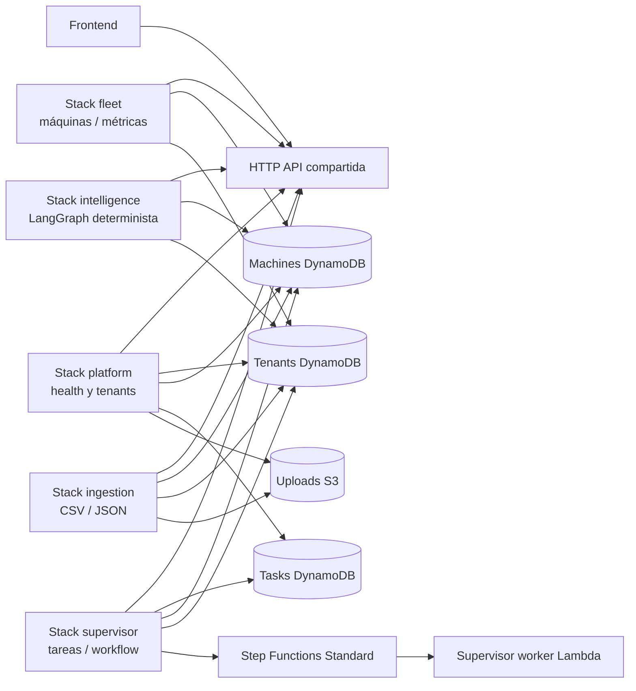

# Hardening local y preparación de AWS Academy

## Alcance y estado

Esta fase modifica únicamente el repositorio local. No se usaron credenciales, no se consultó AWS/GCP y no hubo despliegues. Al inicio Git estaba limpio en `main`; no se crearon commits ni se cambió de rama.

Estado actual: el backend continúa siendo un workspace TypeScript común y comparte contratos/adaptadores compilados, pero ahora dispone de cinco configuraciones Serverless y puntos de entrada Lambda por dominio. Esto permite stacks de despliegue independientes, no procesos de desarrollo independientes ni bases de datos aisladas. La separación real en AWS depende de desplegar primero la plataforma y pasar a cada stack valores concretos de recursos compartidos.

## Topología y propiedad de recursos



`cloud/aws/serverless.yml` es el stack fundacional `arquifusion-platform`: es propietario de HTTP API, funciones health/tenants, tabla legacy, tabla activa de máquinas, tabla tenants/memberships, tabla tasks y bucket de originales. `cloud/aws/serverless.fleet.yml`, `serverless.ingestion.yml`, `serverless.intelligence.yml` y `serverless.supervisor.yml` poseen exclusivamente sus funciones/rutas; Supervisor también posee la state machine. Los stacks de dominio adjuntan rutas a la API existente con `HTTP_API_ID`; no crean otra API ni copian las tablas/bucket.

La distribución de datos se configura por variables (`MACHINES_TABLE`, `TENANTS_TABLE`, `TASKS_TABLE`, `UPLOADS_BUCKET`, `TASK_STATE_MACHINE_ARN`) y el identificador de HTTP API. Los outputs del stack fundacional publican nombres/ID; no se usan imports CloudFormation entre stacks, para permitir su empaquetado y ciclo de vida independiente. Es responsabilidad del operador pasar valores del mismo stage/región/cuenta. No se debe borrar `platform` mientras haya stacks de dominio: eliminar primero los dominios. Actualizar o quitar un stack de dominio no requiere actualizar los otros, aunque eliminar rutas requiere confirmar que ese stack es el propietario de las rutas correspondientes.

Empaquetado previsto desde `cloud/aws/`:

```powershell
npx serverless package --config serverless.yml --stage <stage> --region <region>
npx serverless package --config serverless.fleet.yml --stage <stage> --region <region>
npx serverless package --config serverless.ingestion.yml --stage <stage> --region <region>
npx serverless package --config serverless.intelligence.yml --stage <stage> --region <region>
npx serverless package --config serverless.supervisor.yml --stage <stage> --region <region>
```

El primer despliegue futuro sería `platform`, seguido por cada dominio. Cada servicio se puede actualizar o eliminar con su propio `--config`. Las variables de recursos compartidos deben mantenerse iguales por stage. El stack fundacional es una dependencia operativa, no una pila monolítica que deba actualizarse para cada cambio de Fleet.

`createApiHandlers` continúa siendo la composición del servidor local completo. Las entradas Lambda en `cloud/aws/src/api/domains/` componen solo las dependencias de su dominio y las configuraciones restringen qué variables cloud son obligatorias. El código fuente/paquete npm sigue siendo compartido: la independencia lograda es de stack y entrypoint, no de repositorio, workspace o despliegue de artefactos versionados.

## Servicios y dependencias

| Dominio | Entrada y rutas | Dependencias runtime | Recursos que consume | Stack independiente |
|---|---|---|---|---|
| Platform | `api/domains/platform.ts`; health y tenants | core config, tenancy, storage | tenants; es propietario de API/tablas/bucket compartidos | Sí; base obligatoria |
| Fleet | `api/domains/fleet.ts`; máquinas y métricas | core, fleet, metrics, storage, tenancy | machines + tenants | Sí |
| Ingestion | `api/domains/ingestion.ts`; CSV/JSON | ingestion, storage, tenancy | machines + tenants + bucket | Sí |
| Intelligence | `api/domains/intelligence.ts`; recomendaciones y agentes | LangGraph determinista, fleet/storage, tenancy | machines + tenants | Sí; no hay modelo externo |
| Supervisor | `api/domains/supervisor.ts`; tareas, eventos, worker | supervisor + workflow de inteligencia + storage | tasks + machines + tenants + Step Functions | Sí; estado de workflow propio |
| Metrics | Integrado en Fleet | consultas completas del repositorio Fleet | machines | No requiere stack propio hoy |
| Notifications | Gmail adapter no configurado | OAuth pendiente | Ninguno | No es servicio desplegable |

Los handlers no llaman las funciones HTTP de otro dominio. Los dominios se conectan por contratos y recursos compartidos, no por importaciones de implementaciones cruzadas. Cada stack apunta a un módulo JavaScript compilado bajo `dist/api/domains/`; el validador comprueba que ese artefacto exista y que tenga fuente TypeScript. El storage package contiene fábricas reutilizables, aunque importa adaptadores del workspace; no se ha dividido en paquetes npm separados. Local conserva su servidor único y configuración explícita sin requerir credenciales.

## IAM y AWS Academy LabRole

No se crean roles ni políticas IAM. Cada YAML permite una ARN de rol preexistente en `provider.iam.role` y overrides `functions.<name>.role`. `AWS_LAMBDA_ROLE_ARN` es el modo compatible con Academy/LabRole; las variables opcionales por función permiten separación si el laboratorio ya ofrece esos roles. Esta configuración no crea los roles override. `AWS_STEP_FUNCTIONS_ROLE_ARN` es una identidad distinta preexistente para Step Functions.

| Funciones | Acceso runtime mínimo que necesita el código | Override opcional |
|---|---|---|
| health | Logs CloudWatch | `HEALTH_ROLE_ARN` |
| tenants read/write | Logs; lectura/query/transacciones de tenants; escritura solo en create | `TENANT_READ_ROLE_ARN`, `TENANT_WRITE_ROLE_ARN` |
| Fleet read | Logs; lectura/query de machines y membresías | `FLEET_READ_ROLE_ARN` |
| Ingestion | Logs; escritura condicional/upsert de machines, lectura necesaria para autorizaciones; `s3:PutObject` solo al prefijo de imports | `INGESTION_WRITE_ROLE_ARN` |
| Intelligence | Logs; lectura de machines y tenants | `INTELLIGENCE_READ_ROLE_ARN` |
| Supervisor submit | Logs; acceso requerido a tasks/idempotency/events, lectura de máquinas; `states:StartExecution` sobre su state machine | `SUPERVISOR_SUBMIT_ROLE_ARN` |
| Supervisor queries/overview | Logs; lectura/query tasks/events y máquinas cuando aplique | `SUPERVISOR_READ_ROLE_ARN`, `SUPERVISOR_OVERVIEW_ROLE_ARN` |
| Supervisor worker/dead letter | Logs; lectura/escritura condicional y transaccional tasks/events; lectura de machines | `SUPERVISOR_WORKER_ROLE_ARN` |
| State machine | `lambda:InvokeFunction` únicamente sobre `runTask` y `markTaskDeadLetter` | `AWS_STEP_FUNCTIONS_ROLE_ARN` |

La matriz expresa acciones derivadas del código, no una política IAM generada ni comprobada. En modo rol compartido, LabRole debe satisfacer la unión de estos permisos y cualquier permiso de logging/API Gateway exigido por la plataforma. Separar el ARN en YAML reduce permisos efectivos solo si cada ARN apunta a un rol ya existente con una política realmente limitada. Revisar LabRole y sus permisos en AWS Academy posteriormente; esta fase no accedió a la cuenta. Separar identidad de despliegue y roles de ejecución: el actor que ejecuta Serverless también necesita permisos de despliegue/lectura de estado/CloudFormation, y no es el rol de Lambda.

Las variables se listan vacías en `.env.example`; no rellenar con credenciales reales. Variables principales: `AWS_LAMBDA_ROLE_ARN`, `AWS_STEP_FUNCTIONS_ROLE_ARN`, roles opcionales por función, `AWS_ACCOUNT_ID`, `AWS_REGION`, `HTTP_API_ID`, `MACHINES_TABLE`, `LEGACY_MACHINES_TABLE`, `TENANTS_TABLE`, `TASKS_TABLE`, `UPLOADS_BUCKET`, `TASK_STATE_MACHINE_ARN`, `COGNITO_ISSUER`, `COGNITO_AUDIENCE`, `WEB_ORIGIN`.

## Concurrencia de tareas

`TaskRecord.version` inicia en 1. Lecturas de registros históricos sin ese campo los interpretan como versión 1; la primera actualización condicional los migra al formato versionado. Cada transición válida incrementa versión. `task-state.ts` limita transiciones, mantiene inmutables tenant/task/execution/idempotency, y rechaza transiciones inválidas con `TaskConflictError`.

En DynamoDB, `DynamoTaskStore` lee consistentemente y usa `TransactWriteItems`: actualiza la fila de tarea condicionando versión anterior, estado anterior y claim cuando corresponde, y crea el evento con una clave determinista y condición de inexistencia en la misma transacción. Una versión obsoleta falla como conflicto (no se informa éxito). Una repetición exacta de una transición ya confirmada devuelve el estado actual y no añade evento duplicado. Esto ofrece atomicidad entre registro y evento en DynamoDB, sujeto a las garantías/errores de servicio real que aún deben validarse.

Un claim condicional mueve QUEUED/RETRYING a RUNNING, registra worker/execution y lease de 315 s (el timeout de worker es 300 s); solo un worker obtiene el claim. El mismo worker/execution reintentado con lease activo es idempotente. Claim activo de otro worker genera conflicto; claims expirados se pueden recuperar y esa adquisición incrementa versión/attempts y registra evento. El claim se verifica en actualizaciones del worker.

El store local serializa operaciones en proceso y escribe archivo local; prueba las reglas, pero no garantiza coordinación de varios procesos. El adaptador de prueba Dynamo modela las condiciones/transacciones y no sustituye DynamoDB Local ni una cuenta real. La recuperación de claims abandonados es oportunista cuando vuelve a invocarse el worker: no hay sweeper/redrive automático del claim. Los fallos terminales se guardan como `DEAD_LETTER` en la tabla, no como SQS DLQ. Step Functions conserva el retry/catch del workflow, pero sus garantías de entrega y ejecución no se simulan totalmente en local.

## Validación ejecutada y límite de Serverless

Verificado localmente en esta revisión:

- `npm ci --ignore-scripts`: instalación limpia con workspaces reubicados; 95 paquetes instalados, 0 vulnerabilidades reportadas.
- `npm test`: backend 50/50, frontend 7/7 y Python 2/2. Incluye verificación JWT local, aislamiento adversarial tenant A/B, concurrencia/claims/eventos del Supervisor y validación del esquema compartido.
- Se amplió el tiempo de espera de una prueba del worker local en segundo plano tras observar una carrera de 500 ms durante la instalación limpia; la suite completa volvió a pasar 50/50.
- `npm run build`: compilación TypeScript, build Vite y compilación sintáctica Python aprobados.
- `npm run infra:validate`: pasa comprobaciones estructurales de cinco YAML Serverless, 17 funciones, 15 rutas únicas, propiedad de recursos, referencias de roles, JWT, almacenamiento retenido y workflow Standard.
- El contexto Docker se comprobó estáticamente: ambos orígenes `COPY` existen en la raíz del monorepo. `docker build` no se pudo ejecutar porque el Docker Engine local no estaba disponible (`docker_engine` no encontrado).
- Las configuraciones se parsearon con Serverless Framework 4.46.0 (`--version`) sin credenciales.
- `serverless package` para las cinco configuraciones se intentó con variables ficticias no persistidas y sin credenciales. Framework v4 se detuvo en su requisito de sesión/licencia antes de empaquetar: “You must sign in or use a License Key”. No se inició sesión ni se configuró licencia, no se produjeron artefactos y no se validó el esquema/resolución AWS completo. No se ejecutó `serverless deploy`.
- La validación estática propia NO equivale a `cfn-lint`, SAM ni validación oficial de CloudFormation. La integración real en API Gateway existente, nombres lógicos/output, permisos y aceptación del LabRole quedan pendientes.

Los stacks de dominio comparten el código backend, por tanto el criterio de compilar el workspace se cumple pero el empaquetado Serverless independiente todavía no quedó demostrado por el bloqueo de licencia local. No se debe presentar como paquete probado hasta ejecutar los comandos anteriores en un entorno con Framework v4 habilitado y sin despliegue.

## Procedimiento AWS Academy posterior (no ejecutar en esta fase)

1. Confirmar en Academy región/cuotas y permisos para API Gateway, Lambda, DynamoDB, S3, Step Functions y Cognito; revisar ARN y permisos efectivos de LabRole. Comprobar también permisos de despliegue del usuario del laboratorio.
2. Preparar variables no secretas por stage, con nombres únicos de tabla/bucket y API; configurar issuer/audience y origen permitido. Seleccionar overrides únicamente para roles preexistentes autorizados.
3. Con Serverless Framework v4 licenciado, ejecutar `serverless package --config ...` para los cinco manifests, inspeccionar artifacts/templates y verificar API existente/rutas, recursos e IAM generados antes de cualquier despliegue.
4. Desplegar y verificar primero `platform`; registrar outputs `HttpApiId`, nombres de tablas y bucket. A continuación empaquetar/desplegar cada dominio pasando esos outputs como configuración y el mismo stage/región.
5. Para retirar una parte, eliminar primero stacks de dominio que dependan de platform; validar el efecto de Retain en datos antes de operar. No eliminar foundation mientras conserve datos compartidos.
6. Probar Cognito, rutas autorizadas, tenants A/B, importación y originales, condiciones concurrentes DynamoDB, workflow/retries y costes en una cuenta de prueba.

Ejemplos futuros (requieren revisión/aprobación operativa y no se han ejecutado):

```powershell
Set-Location C:\Users\anton\Desktop\HackCloud\backend
npx serverless deploy --config serverless.yml --stage <stage> --region <region>
npx serverless deploy --config serverless.fleet.yml --stage <stage> --region <region>
npx serverless deploy --config serverless.ingestion.yml --stage <stage> --region <region>
npx serverless deploy --config serverless.intelligence.yml --stage <stage> --region <region>
npx serverless deploy --config serverless.supervisor.yml --stage <stage> --region <region>
```

Para actualizar un dominio se repite solamente su comando `deploy --config ...`; para retirarlo, `npx serverless remove --config serverless.<dominio>.yml --stage <stage> --region <region>`. No quitar `platform` hasta retirar todos los dominios; las tablas y el bucket de foundation declaran `Retain` para conservar datos.

No se recomienda ejecutar hasta completar la inspección de outputs/configuración y permisos indicada arriba. Google Cloud y Cloudflare tienen guías independientes en `cloud/gcp/intelligence/README.md` y `apps/frontend/README.md`; ninguno se desplegó durante esta fase.
